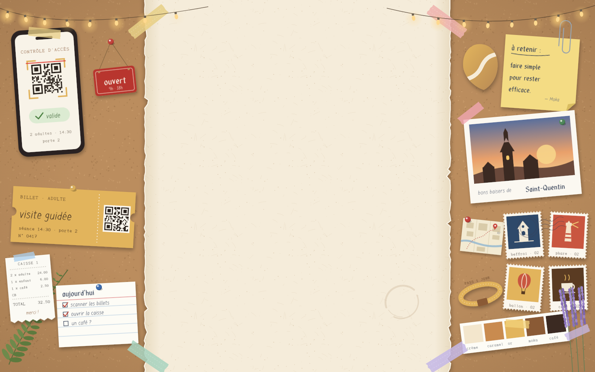
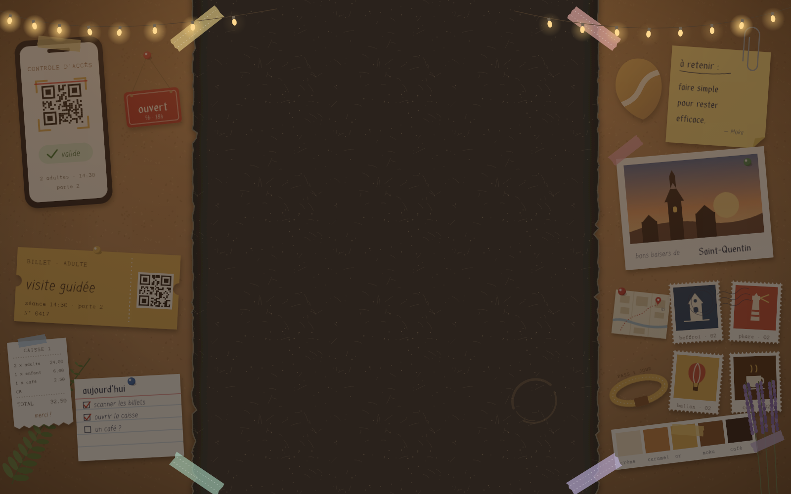

# Moka Tourisme, thème pour Claude Code

Un fond en liège pour l'app de bureau et le mobile de Claude Code, dans le style du thème
[pinboard](https://github.com/zjlgdx/pinboard) : une journée sur un site touristique épinglée
autour de la conversation. Téléphone qui scanne un billet, billet d'entrée, pancarte « ouvert »,
ticket de caisse, carte postale, plan, bracelet d'accès, timbres et nuancier aux couleurs Moka.
La guirlande et la ligne de scan s'animent pendant que Claude travaille.

| Jour | Nuit |
| --- | --- |
|  |  |

## Installation

Dans un terminal Claude Code :

```
/plugin install moka-tourisme --marketplace Rom10811/theme-moka
```

Depuis un shell :

```bash
claude plugin install moka-tourisme --marketplace Rom10811/theme-moka
```

Dans l'app de bureau, où `/plugin` ne s'exécute pas : cliquer sur + à côté de la zone de saisie,
puis Plugins, Add marketplace avec `Rom10811/theme-moka`, puis Add plugin.

Le thème ne s'affiche que dans l'app de bureau et sur mobile ; un terminal garde ses propres couleurs.
Si un autre thème (pinboard par exemple) est actif, c'est le dernier posé qui s'affiche.

## Licence

MIT, d'après pinboard (zjlgdx). Le logo Moka reste la propriété de Moka Tourisme. Voir `LICENSE`.
